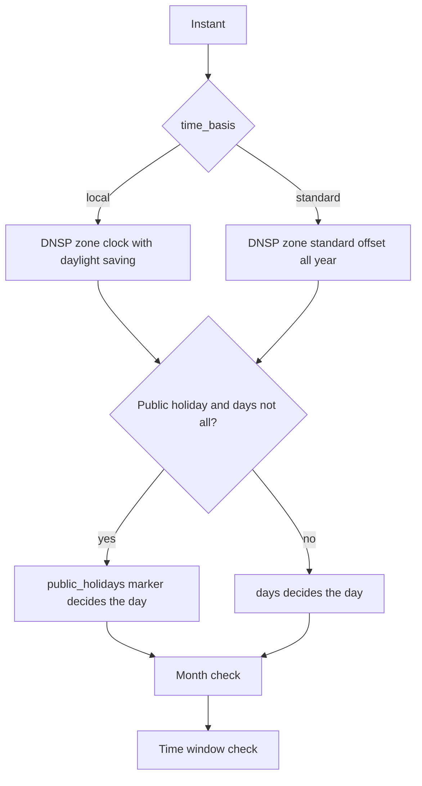
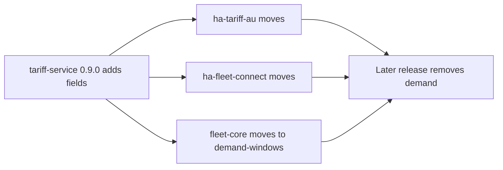

# Demand model and time basis design

Status: awaiting maintainer review, 2026-11-09. Release `feat/0.9.0`. Issues: #31, #56, and the
field #61 needs.

## Intent

| Need | Constraint |
|---|---|
| A tariff holds seasonal demand rates, kW or kVA pricing, a rolling 12-month peak and several demand charges | One new structure, `demand_charges` |
| A consumer can get the demand rate in force at a given time | NASN12 reads 2.862 from April to November and 11.473 from December to March |
| Windows fixed to standard time resolve correctly | Jemena A180 is correct during daylight saving |
| Weekday windows follow public holidays where the source says so | Holidays by DNSP state, state-wide only |
| Prices due for replacement can raise alerts (#61) | `prices_expected_until` never affects which version is in force |
| Installed consumers keep working | 0.9.0 removes no field. The service deploys on merge and users update Home Assistant integrations at their own pace |

Out of scope: calculating export charges in dollars, correcting seed data beyond NASN12 and
A180 (#56, #62, #46), and consumer changes (Rollout).

## Stored data

Each tariff version row gains:

| Field | Values | Rule |
|---|---|---|
| `time_basis` | `local`, `standard` | Required. Applies to every energy, demand and export window of the tariff |
| `prices_expected_until` | date or null | Drives #61 alerts only. Seeded on each tariff's last version from the file-level `effective_to` plus one day: 2027-06-30 becomes 2027-07-01. Citipower, Powercor, United Energy and Energex files state no end, and use 2027-07-01, the next annual price change |

`tariff_demand_charge` replaces `tariff_demand`, with one row per charge and season:

| Field | Type | Values |
|---|---|---|
| `tariff_id` | int | Tariff version |
| `period` | str | `peak`, `shoulder`, `off_peak`, `anytime` |
| `rate` | float | Per `unit` per month. Per-day source rates x 30, per-year rates / 12 |
| `unit` | str | `kW`, `kVA` |
| `start`, `end` | str | HH:MM, as the DNSP states them. `start` equal to `end` is all day |
| `days` | str | `all`, `weekdays`, `weekends` |
| `public_holidays` | str or null | `included`, `excluded`. Required unless `days` is `all` |
| `months` | list[int] or null | Null is all year |
| `measurement_method` | str | As `tariff_demand` |
| `peak_period` | str | `month`, `rolling_12_months` |

`public_holidays` decides a window on a public holiday. A window with `days` `all` runs every day, whatever its marker. Otherwise `excluded` switches the window off. `included` switches a `weekends` window on, and leaves a `weekdays` or `all` window to its `days` value, so a `weekdays` window applies on a weekday holiday and not on a weekend holiday. Energy rate and export
rows gain the same field with the same rule. The tariff version in force is chosen on the DNSP's local date. Ausgrid weekdays are `excluded` and its weekends
`included`. Power and Water weekdays are `included`.

Export rows gain:

| Field | Values |
|---|---|
| `free_threshold_period` | `day`, `year`, or null when there is no threshold |
| `free_threshold_rollover` | `none`, `billing_period`, `billing_period_like_days`, or null when there is no threshold |

Nothing calculates from either field. `tariff_type` is unchanged, and its description states
that it does not indicate exports: consumers read the `export` list.

### Rules

- Date, weekday, month and holiday are all judged on the tariff's clock.
- On a local clock a time the clock skips matches no instant, and a time it repeats matches
  both readings. Window listings and window checks follow this one rule (#63).
- The `demand` response object is built from the charge with the highest rate. A tie goes to
  the earliest `start`. It is not stored.
- The seed load rejects a tariff with no `time_basis`, a window with no required
  `public_holidays`, an unrecognised `days` value, or demand charges mixing kW and kVA.

### Seed migration

Every seed moves to the new shape with its existing values.

| Field | Migrated value |
|---|---|
| `time_basis` | `local`, except Jemena A180 `standard`. #56 checks each DNSP and marks the rest |
| `public_holidays`, Ausgrid, Endeavour, CitiPower, Powercor, United Energy | Weekdays `excluded`. No seeded row is weekends-only, so a holiday falls to the tariff's all-days rate |
| `public_holidays`, Power and Water | Weekdays `included` |
| `public_holidays`, every other DNSP | `included`, which keeps today's result. #62 checks each source |
| `period`, demand | `anytime` where `start` equals `end`, otherwise `peak` |
| `unit`, demand | `kW`. #62 corrects kVA tariffs |
| `peak_period`, demand | `month`. #62 corrects rolling 12-month tariffs |
| `free_threshold_period` | `day` where a threshold is seeded |
| `free_threshold_rollover` | `billing_period` for SAPN RSR, BSR, RTOU, RESELE; `billing_period_like_days` for SAPN SBTOU, MBTOUD, SBELE; `none` for AusNet RCER11 |

NASN12 gains its April to November charge (2.862 $/kW/month). A180 is corrected to
`standard`. The EA029 allowance of 2,500 kWh a year is seed data for #62.

## Calculation

One function decides whether a window applies at an instant, for energy, demand and export.

A request with no offset is read on the DNSP's local clock first, then converted. A small
module wraps the `holidays` package and looks up the DNSP's `state`.

| Endpoint | Change |
|---|---|
| `/tariffs/{dnsp}/{code}` | Adds `demand_charges`, `time_basis`, `prices_expected_until`, `public_holidays` on rates and exports, and the two export fields. `demand` stays, built as above |
| `/calculate/current-rate` | Selects rates with the shared function. Adds `demand_charges` |
| `/calculate/demand-windows` | Same URL, range limit and 404 rules. Each window gains `rate` |
| `/calculate/demand-surcharge` | Unchanged, reads the built `demand` |
| Demand methodology docs | Unchanged response, reads the built `demand` |

`current-rate` `demand_charges` lists every charge whose `months` cover the date, each with
`period`, `rate`, `unit`, `peak_period` and `active`. `active` is true only inside the charge's
window. `in_demand_window` is true when any entry is active.

`demand-windows` builds each date from the version in force that date. Each charge in season
produces its windows. Where charges overlap the higher rate takes the stretch. Adjacent
stretches merge only at an equal rate.

## Contract changes

tariff-service responses have no JSON model in fleet-core `docs/spec/*/models/`, and fleet-core
holds the tariff payload without a strict schema. Checked 2026-11-09. No model changes.

| Response | Field change | Kind | Consumers |
|---|---|---|---|
| Tariff detail | `demand_charges`, `time_basis`, `prices_expected_until` | Additive | ha-tariff-au, ha-fleet-connect, fleet-core after Rollout |
| Tariff detail, `rates[]` and `export[]` | `public_holidays` | Additive | Same |
| Tariff detail, `export[]` | `free_threshold_period`, `free_threshold_rollover` | Additive | None yet |
| Current rate | `demand_charges` | Additive | ha-tariff-au after Rollout |
| Demand windows | `windows[].rate` | Additive | fleet-core after Rollout |
| Current rate, demand windows | Results follow holidays, time basis and all charges | Behaviour | Listed in `CHANGELOG.md` |
| Tariff detail | `demand` removed | Breaking, later release | Rollout |

Version bump: `0.9.0`.

## Rollout

0.9.0 alone leaves the `ha-tariff-au` NASN12 sensors as they are: the integration reads
`demand` and matches windows itself. fleet-core likewise reads `demand` until its planned move
to `/calculate/demand-windows` is built.

Issues filed once this spec is approved:

| Repo | Work |
|---|---|
| ha-tariff-au | Read `demand_charges` and the `current-rate` list. Follow `time_basis` and holidays, or use the service's answers |
| ha-fleet-connect | Move the Demand Window entity off `demand` |
| fleet-core | Build the move to `/calculate/demand-windows` and decide how it uses `rate` |

Removing `demand` is parked in the backlog. Precondition: all three consumers have released
their move and the maintainer decides enough time has passed.

## Testing

Tests use the real seed through the database build. Each behaviour has a failing test first.

| Area | Cases |
|---|---|
| Seasons | NASN12 on Wednesday 10:00 and 17:00 in November (2.862, inactive then active), Wednesday 17:00 in December (11.473, active), and the 31 March and 1 April boundaries |
| Clock | A180 at 2026-11-11 07:30+11:00 returns its off-peak rate and 23:30+11:00 returns `none`. Winter results are unchanged. A `standard` window at 23:30 standard time is judged on that date |
| No daylight saving | A `standard` tariff in Queensland matches `local` |
| Public holidays | Christmas Day 2026, a Friday, at 17:00: Ausgrid EA302 returns `off_peak` and no demand window, Power and Water T5 stays in its demand window. A holiday in one state does not affect a DNSP in another |
| Several charges | A synthetic tariff with peak and shoulder charges: splitting, the higher rate taking an overlap, merging only at an equal rate |
| `active` | In season with the window shut, in season with it open, out of season is not listed |
| `demand` | For every seeded tariff it equals the 0.8.0 response. The NASN12 and A180 corrections leave it unchanged |
| Seed rejection | No `time_basis`, no required `public_holidays`, unknown `days`, kW and kVA mixed |
| Exports | RSR is `billing_period`, SBTOU is `billing_period_like_days` |
| `prices_expected_until` | Set on every tariff's last version, and changing it never changes the version in force |

The `#31` strict xfails pass as each gap gets a place in the model. A gap that also needs
corrected data keeps its xfail, pointing at #62 or #46.

After the deploy, the live check compares NASN12 and A180 on the real API at the times above.

## Assumptions to verify in Build

- `holidays` declares an allowed licence (`.agent/pre-commit-rules.md`).
- Each DNSP's holiday treatment is state-wide. The captured sources do not name a holiday list,
  and the service holds one state per DNSP.
- No seeded tariff mixes `local` and `standard` windows. A per-window override can be added
  without a breaking change if one appears.
- No seeded tariff mixes kW and kVA demand charges.
